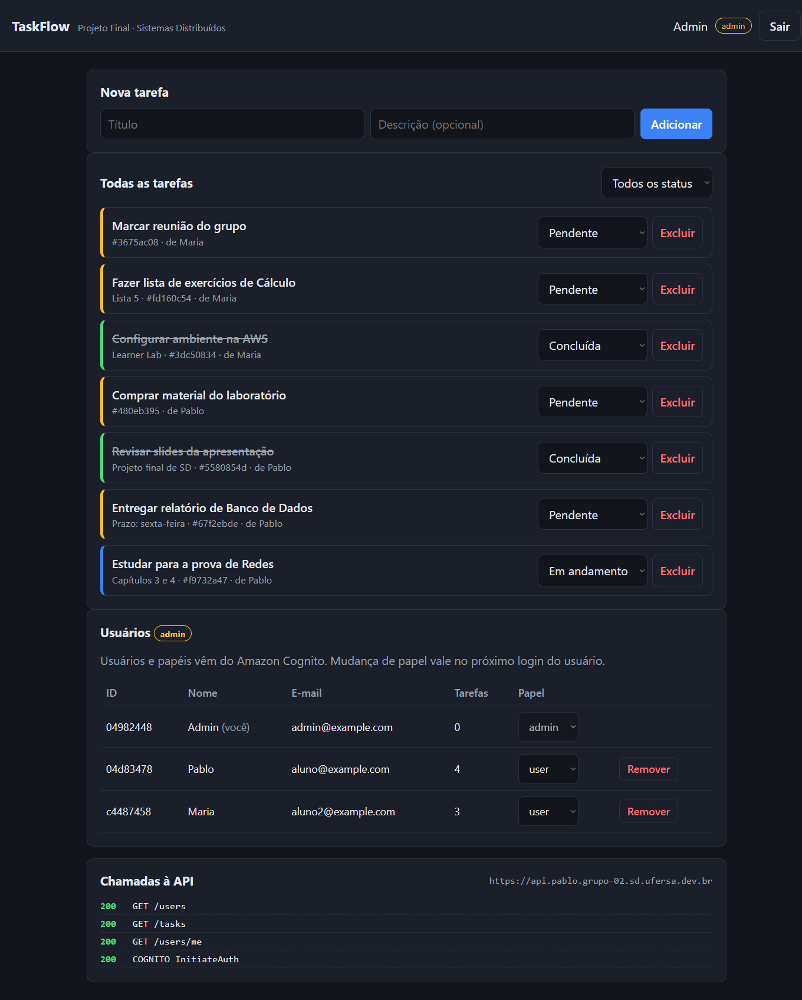

# TaskFlow

Gerenciador de tarefas **serverless na AWS**, construído em **arquitetura de três camadas** com API REST, autenticação via Amazon Cognito e domínio próprio no Route 53.

Projeto final da disciplina de **Sistemas Distribuídos**, UFERSA (2026.2).



## Funcionalidades

- Cadastro e login de usuários (Amazon Cognito)
- Criar, editar status, filtrar e excluir tarefas
- Dois perfis de acesso:
  - **user**: vê e altera apenas as próprias tarefas
  - **admin**: vê as tarefas de todos e gerencia usuários (promover a admin e remover)
- Painel "Chamadas à API" que mostra em tempo real cada requisição feita pelo frontend e o status HTTP

## Arquitetura

```
 Navegador
    │  DNS (Route 53): pablo.grupo-02.sd.ufersa.dev.br
    ▼
 ┌──────────────────────────┐
 │ APRESENTAÇÃO             │  Amplify Hosting: HTML/CSS/JS
 └───────┬──────────┬───────┘
         │ login    │ HTTPS + token JWT no cabeçalho Authorization
         ▼          ▼   DNS (Route 53): api.pablo.grupo-02.sd.ufersa.dev.br
 ┌────────────┐ ┌──────────────────────────┐
 │  COGNITO   │ │ NEGÓCIOS                 │  API Gateway (REST): valida o token
 │ (usuários, │◄┤                          │  Lambda (Node.js 22): regras de negócio
 │  grupos)   │ └───────┬──────────────────┘
 └────────────┘         ▼
                ┌──────────────────────────┐
                │ DADOS                    │  DynamoDB
                └──────────────────────────┘
```

| Camada / requisito | Serviço AWS | Responsabilidade |
|---|---|---|
| Apresentação | Amplify Hosting | Hospeda o frontend estático (`web/`) |
| Negócios | API Gateway + Lambda | API REST; validação e regras de acesso (`src/`) |
| Dados | DynamoDB | Tabela `taskflow-tasks` com índice `byUser` |
| Autenticação | Cognito User Pool | Cadastro, login e emissão de tokens JWT |
| Autorização | API Gateway (Cognito authorizer) + Lambda | 401 sem token válido; 403 para quem não é dono nem admin |
| DNS | Route 53 + ACM | Domínios do app e da API, com HTTPS |

Toda a infraestrutura é declarada em [`template.yaml`](template.yaml) (**Infraestrutura como Código** com AWS SAM/CloudFormation) e criada com um único comando.

## Tecnologias

- **Frontend:** HTML, CSS e JavaScript puro (sem frameworks); chamadas diretas à API do Cognito e à API REST via `fetch`
- **Backend:** Node.js 22 em AWS Lambda, AWS SDK v3
- **Infraestrutura:** AWS SAM / CloudFormation, API Gateway, DynamoDB, Cognito, Amplify, Route 53, Certificate Manager
- **Testes:** `node:assert`, com DynamoDB e Cognito simulados em memória

## API REST

Base: `https://api.pablo.grupo-02.sd.ufersa.dev.br`. Rotas protegidas exigem o **ID token do Cognito** no cabeçalho `Authorization`.

| Método | Recurso | Acesso | Respostas |
|---|---|---|---|
| GET | `/` | público | 200: descrição dos recursos |
| GET | `/health` | público | 200 / 503: status da API e do banco |
| GET | `/users/me` | autenticado | 200 |
| GET | `/users` | admin | 200, 403 |
| PATCH | `/users/{id}` | admin | 200, 400, 403, 404 |
| DELETE | `/users/{id}` | admin | 204, 400, 403, 404 |
| GET | `/tasks?status=` | autenticado (admin vê todas) | 200, 400 |
| POST | `/tasks` | autenticado | 201 + `Location`, 400 |
| GET | `/tasks/{id}` | dono ou admin | 200, 403, 404 |
| PATCH | `/tasks/{id}` | dono ou admin | 200, 400, 403, 404 |
| DELETE | `/tasks/{id}` | dono ou admin | 204, 403, 404 |

Status de tarefa: `pendente`, `em_andamento`, `concluida`.

```bash
API=https://api.pablo.grupo-02.sd.ufersa.dev.br
curl -s $API/health                  # 200: público
curl -s -i $API/tasks | head -1      # 401: sem token

TOKEN=$(aws cognito-idp initiate-auth --client-id <CLIENT_ID> --auth-flow USER_PASSWORD_AUTH \
  --auth-parameters USERNAME=aluno@example.com,PASSWORD='senha1234' \
  --query AuthenticationResult.IdToken --output text)

curl -s -H "Authorization: $TOKEN" $API/tasks
curl -s -X POST -H "Authorization: $TOKEN" -H "Content-Type: application/json" \
     -d '{"title":"Estudar para a prova","description":"Capítulo 3"}' $API/tasks
```

## Estrutura do projeto

```
template.yaml            infraestrutura completa (SAM/CloudFormation)
src/
  tasks.mjs              recurso /tasks
  users.mjs              recurso /users
  public.mjs             GET / e GET /health
  presignup.mjs          gatilho do Cognito (confirma o cadastro automaticamente)
  common.mjs             utilitários compartilhados
web/                     frontend (config.js é gerado no deploy)
scripts/
  deploy.sh              implanta tudo e publica o frontend
  make-admin.sh          coloca um usuário no grupo admin
tests/                   testes das Lambdas
img/                     imagens do README
```

## Como implantar

Pensado para o **AWS Academy Learner Lab**: as Lambdas usam a role `LabRole`. Em uma conta AWS comum, troque `LabRole` no `template.yaml` por uma role com acesso ao DynamoDB e ao Cognito.

Pré-requisito: uma hosted zone no Route 53 para o domínio, com a delegação de NS ativa. Sem ela, o script implanta usando a URL padrão do API Gateway.

1. No **AWS CloudShell**, envie o projeto e rode:
   ```bash
   bash scripts/deploy.sh
   ```
   O script cria a infraestrutura, gera `web/config.js` e publica o site no Amplify. Para outro domínio, use `DOMAIN=meu.dominio.com bash scripts/deploy.sh`.
2. No console do **Amplify** → *Custom domains*, adicione o domínio do app apontando para o branch `main`.
3. Cadastre-se pelo site e promova sua conta a admin:
   ```bash
   bash scripts/make-admin.sh seu-email@example.com
   ```

Para atualizar, rode o `deploy.sh` de novo: apenas o que mudou é alterado. Para remover tudo: `sam delete --stack-name taskflow`.

## Testes

```bash
npm install
npm test
```

Os testes executam os handlers das Lambdas com DynamoDB e Cognito simulados em memória, sem acessar a AWS. Eles cobrem o CRUD, as validações (400), as regras de autorização (403), recursos inexistentes (404) e a remoção em cascata das tarefas de um usuário.
